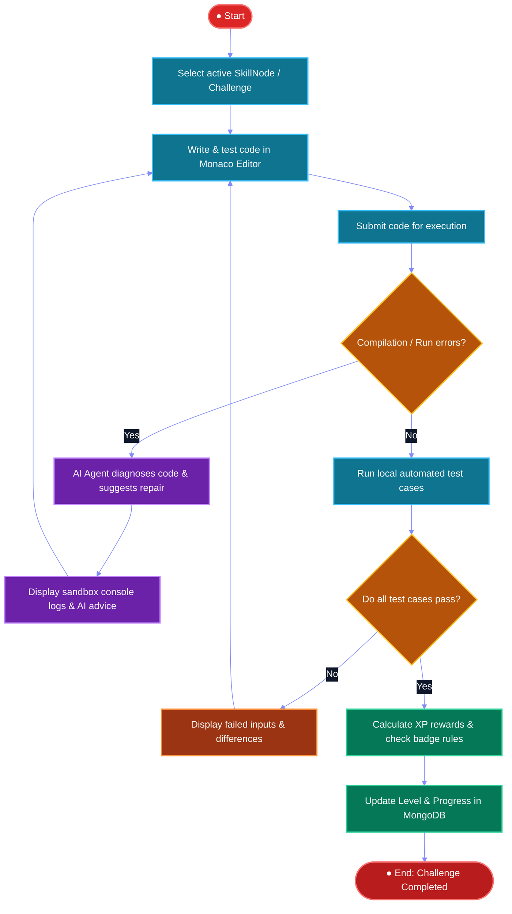

# 🔄 CodeGalaxy: UML Activity Diagram Specification

## Figure 6: Activity diagram for challenge submission: compilation/run-error handling, local test-case evaluation, and XP/level accounting on a fully-passing run.

---

### 1. Vector Mermaid Activity Flowchart

---

## 2. Activity Lifecycle & Transition Logic

### **1. Selection & Authoring**
- **Activity**: `Select active SkillNode / Challenge`
  - Learner selects a planetary skill node from the solar system map or clicks a challenge in the catalog.
- **Activity**: `Write & test code in Monaco Editor`
  - Monaco editor loads language boilerplates (`JavaScript`, `Python`, `C++`, `Java`). The learner edits and tests code interactively.
- **Activity**: `Submit code for execution`
  - Submits the solution payload to `/api/challenges/run` triggering the backend local sandbox execution engine.

---

### **2. Guard Condition 1: Compilation / Runtime Check**
- **Decision Node**: `Compilation / Run errors?`
  - Evaluates compiler status and runtime signals from [executeCode.js](file:///c:/Users/harsh/OneDrive/Desktop/CodeGalaxy%20AD/backend/utils/executeCode.js).
- **Branch: [Yes] (Compilation / Runtime Exception)**:
  - **Action**: `AI Agent diagnoses code & suggests repair`
    - Triggered via [aiController.js](file:///c:/Users/harsh/OneDrive/Desktop/CodeGalaxy%20AD/backend/controllers/aiController.js).
    - Multi-provider AI orchestrator analyzes `stderr` traces and code syntax without revealing full solution spoilers.
  - **Action**: `Display sandbox console logs & AI advice`
    - Renders compiler errors and suggested hints in the output panel.
  - **Loopback**: Transitions back to `Write & test code in Monaco Editor` for debugging.
- **Branch: [No] (Clean Compilation)**:
  - Proceeds immediately to automated test suite validation.

---

### **3. Guard Condition 2: Test Case Suite Validation**
- **Action**: `Run local automated test cases`
  - Iterates through the problem's predefined and hidden test cases, piping each input via `stdin` and checking stdout against expected outputs.
- **Decision Node**: `Do all test cases pass?`
- **Branch: [No] (Assertion Failure / Edge Case Missed)**:
  - **Action**: `Display failed inputs & differences`
    - Surfaces test input, expected output, and actual received output in the test feedback runner.
  - **Loopback**: Loops back to `Write & test code in Monaco Editor` to refine algorithm edge cases.
- **Branch: [Yes] (All Assertions Passed)**:
  - Triggers the gamification fulfillment pipeline.

---

### **4. Gamification Accounting & Termination**
- **Action**: `Calculate XP rewards & check badge rules`
  - Awards problem `xpReward` (e.g., +100 XP), increments consecutive activity streak, and evaluates badge criteria.
- **Action**: `Update Level & Progress in MongoDB`
  - Commits atomic update to [UserProgress.js](file:///c:/Users/harsh/OneDrive/Desktop/CodeGalaxy%20AD/backend/models/UserProgress.js), unlocking subsequent planetary nodes on the skill tree.
- **Final Node**: `● End: Challenge Completed`
  - Displays level-up banner and victory animations on the frontend.
