# 🌌 CodeGalaxy System Architecture (High-Definition Specification)


## 1. Architectural Overview & System Design

**CodeGalaxy** is an Agentic AI-driven, gamified, and interactive programming platform designed for full-stack computer science learning. The architecture is engineered around a **decoupled, multi-tier reactive system** spanning four primary layers:
1. **Frontend Presentation & Interaction Client** (React 18 + TypeScript + Vite + Tailwind CSS + Framer Motion)
2. **Backend Application & Orchestration Server** (Express.js 5 + Node.js 18+)
3. **Agentic AI & Computation Engines** (Multi-Provider AI Gateway, Code Execution Sandbox, Local TF-IDF & Vision RAG)
4. **Data Persistence & Storage Layer** (MongoDB Atlas, In-Memory Chunk Index, Qdrant Vector Store Scaffold)

---

## 2. HD System Architecture Diagram

```mermaid
%%{init: {'theme': 'base', 'themeVariables': { 'primaryColor': '#1e1e2e', 'primaryTextColor': '#ffffff', 'primaryBorderColor': '#6366f1', 'lineColor': '#818cf8', 'secondaryColor': '#2d3748', 'tertiaryColor': '#111827' }}}%%
flowchart TB
    %% ==========================================
    %% CLIENT LAYER
    %% ==========================================
    subgraph CLIENT["🖥️ FRONTEND CLIENT (React 18 + TypeScript + Vite)"]
        direction TB
        subgraph UI_CORE["🎨 Interactive UI & Gamification Core (Tailwind + Framer Motion)"]
            SOLAR["🪐 Solar System Skill Tree<br/>(LevelMap / Planetary Nodes)"]
            CHARTS["📊 Recharts Analytics<br/>(Skill Radars & XP Growth)"]
            FORGE_UI["⚔️ Nebula Forge & Lab<br/>(Challenge & Interview Prep)"]
        end

        subgraph INTERACTIVE_ENGINES["⚡ Interactive Engineering Components"]
            MONACO["💻 Monaco Code Editor<br/>(Multi-lang Syntax, Diff & Themes)"]
            FLOW["🔄 Visualizer Engines<br/>(Sorting, LinkedLists & BST Trees)"]
            AUDIO["🎙️ Voice & TTS Interface<br/>(Mock Interview Simulator)"]
        end

        CLIENT_NET["🌐 Client Network Gateway (Axios Interceptors + SSE Stream Consumer)"]
        UI_CORE --> CLIENT_NET
        INTERACTIVE_ENGINES --> CLIENT_NET
    end

    %% ==========================================
    %% NETWORKING PROTOCOLS
    %% ==========================================
    CLIENT_NET -- "REST API (Bearer JWT)" --> ROUTER
    CLIENT_NET -- "Server-Sent Events (SSE Chunks)" --> ROUTER
    CLIENT_NET -- "Multipart Form Data (Uploads)" --> RAG_ROUTES

    %% ==========================================
    %% BACKEND SERVER LAYER
    %% ==========================================
    subgraph BACKEND["⚙️ BACKEND API SERVER (Express 5.2 + Node.js 18+)"]
        direction TB
        
        subgraph MIDDLEWARE["🛡️ Middleware & Security"]
            JWT_SEC["🔐 JWT Auth Middleware (protect / admin)"]
            CORS_M["🌐 CORS & Rate Limiter"]
            MULTER_M["📁 Multer File Buffer Parser"]
        end

        subgraph ROUTER["🔀 Express Route Controllers"]
            direction LR
            AUTH_ROUTES["/api/auth<br/>(Auth Controller)"]
            AI_ROUTES["/api/ai<br/>(AI Controller)"]
            CHALLENGE_ROUTES["/api/challenges<br/>(Challenge Controller)"]
            PROGRESS_ROUTES["/api/progress & /gamification<br/>(XP & Leaderboards)"]
            INTERVIEW_ROUTES["/api/interview-prep<br/>(Interview Controller)"]
            LEARN_ROUTES["/api/learning<br/>(Learning Path)"]
            RAG_ROUTES["/api/rag<br/>(RAG Controller)"]
        end

        subgraph COMPUTE_ENGINES["⚡ Internal Execution & Indexing Subsystems"]
            EXEC_ENGINE["⚙️ Code Execution Sandbox<br/>(child_process Runner)"]
            TFIDF_ENGINE["📑 Vectorless RAG Engine<br/>(TF-IDF + Cosine Similarity)"]
        end

        JWT_SEC --> ROUTER
        CHALLENGE_ROUTES --> EXEC_ENGINE
        RAG_ROUTES --> TFIDF_ENGINE
    end

    %% ==========================================
    %% AGENTIC AI LAYER
    %% ==========================================
    subgraph AGENTIC_AI["🤖 AGENTIC AI ORCHESTRATION LAYER"]
        direction TB
        
        subgraph AI_GATEWAY["🔀 Multi-Provider Gateway & Fallback Manager"]
            GROQ["⚡ Groq LPU API<br/>(Primary: gpt-oss-20b / qwen3.6-27b)"]
            GEMINI["🧠 Google Gemini API<br/>(Secondary & Multimodal Vision)"]
            OLLAMA["🦙 Ollama Local Host<br/>(Offline: qwen2.5-coder / llama3.1)"]
        end

        subgraph AGENT_LOOP["🔄 Autonomous Agent Loop (agentService.js)"]
            PLANNER["1️⃣ Planner Agent<br/>(Deconstructs tasks into 3-6 steps)"]
            EXECUTOR["2️⃣ Execution Agent<br/>(Sequential contextual execution)"]
            SYNTHESIZER["3️⃣ Synthesizer Agent<br/>(Consolidates final deliverable)"]
            PLANNER --> EXECUTOR --> SYNTHESIZER
        end

        subgraph SPECIALIZED_PROMPTS["🎯 Specialized AI Capabilities"]
            COPILOT["🤖 Copilot Logic Analyzer"]
            REPAIR["🛠️ Code Repair & Debug Bot"]
            FORGE["⚔️ Dynamic Challenge Synthesizer"]
            INTERVIEW_AI["👔 Mock Technical Interviewer"]
        end

        AI_GATEWAY <--> AGENT_LOOP
        AI_GATEWAY <--> SPECIALIZED_PROMPTS
    end

    %% ==========================================
    %% COMPILATION RUNTIMES
    %% ==========================================
    subgraph RUNTIMES["💻 SANDBOX COMPILER TOOLCHAINS"]
        direction LR
        CPP_RUN["g++ / gcc<br/>(C / C++)"]
        PY_RUN["python / python3<br/>(Python)"]
        NODE_RUN["node<br/>(JavaScript)"]
        JAVA_RUN["javac / java<br/>(Local JDK auto-detection)"]
    end

    EXEC_ENGINE --> RUNTIMES

    %% ==========================================
    %% DATA STORAGE LAYER
    %% ==========================================
    subgraph STORAGE["💾 DATA & PERSISTENCE LAYER"]
        direction LR
        
        subgraph MONGO_DB["🍃 MongoDB Atlas (Mongoose 9)"]
            USERS[("👤 Users & Credentials")]
            PROGRESS_DB[("🪐 User Progress & XP")]
            CHALLENGES_DB[("⚔️ Challenges & Testcases")]
            PATHS_DB[("🗺️ SkillNodes & Learning Paths")]
            INTERVIEWS_DB[("👔 Assessments & Mock Logs")]
        end

        subgraph MEMORY_STORE["⚡ Fast In-Memory Document Store"]
            DOC_CHUNKS[("📑 PDF/TXT Chunks")]
            TFIDF_INDEX[("🧮 Term Frequencies & Inverted Index")]
        end

        subgraph VECTOR_SCAFFOLD["🔍 Vector Store Scaffold"]
            QDRANT[("💎 Qdrant Vector DB<br/>(@qdrant/js-client-rest)")]
        end
    end

    %% ==========================================
    %% CROSS-TIER CONNECTORS
    %% ==========================================
    AI_ROUTES <==> AGENTIC_AI
    INTERVIEW_ROUTES <==> AGENTIC_AI
    
    TFIDF_ENGINE <==> MEMORY_STORE
    TFIDF_ENGINE -. Optional Embeddings .-> QDRANT
    TFIDF_ENGINE <==> GEMINI

    AUTH_ROUTES <==> USERS
    PROGRESS_ROUTES <==> PROGRESS_DB
    CHALLENGE_ROUTES <==> CHALLENGES_DB
    LEARN_ROUTES <==> PATHS_DB
    INTERVIEW_ROUTES <==> INTERVIEWS_DB

    %% ==========================================
    %% STYLING DIRECTIVES
    %% ==========================================
    classDef clientStyle fill:#0f172a,stroke:#38bdf8,stroke-width:2px,color:#f8fafc;
    classDef backendStyle fill:#064e3b,stroke:#10b981,stroke-width:2px,color:#f8fafc;
    classDef aiStyle fill:#31104b,stroke:#a855f7,stroke-width:2px,color:#f8fafc;
    classDef storageStyle fill:#78350f,stroke:#f59e0b,stroke-width:2px,color:#f8fafc;
    classDef runtimeStyle fill:#1e293b,stroke:#94a3b8,stroke-width:2px,color:#f8fafc;

    class CLIENT,UI_CORE,INTERACTIVE_ENGINES,CLIENT_NET clientStyle;
    class BACKEND,MIDDLEWARE,ROUTER,COMPUTE_ENGINES backendStyle;
    class AGENTIC_AI,AI_GATEWAY,AGENT_LOOP,SPECIALIZED_PROMPTS aiStyle;
    class STORAGE,MONGO_DB,MEMORY_STORE,VECTOR_SCAFFOLD storageStyle;
    class RUNTIMES,CPP_RUN,PY_RUN,NODE_RUN,JAVA_RUN runtimeStyle;
```



---

## 3. Detailed Component Breakdown

### Tier 1: Frontend Client Application
- **Framework & Build**: React 18 with TypeScript compiled via Vite for instant HMR and optimized bundles.
- **Visual Design System**: Tailored dark-mode space aesthetic built with TailwindCSS, Lucide React icons, and Framer Motion micro-animations.
- **Monaco Code Editor**: Integrated `@monaco-editor/react` supporting multiple programming languages (C++, C, Python, JavaScript, Java), custom editor themes, syntax validation, and split-screen code comparisons.
- **Solar System Skill Tree**: Custom canvas/DOM hybrid visualizer mapping computer science concepts to planetary orbits (Variables, Loops, Functions, OOP, Data Structures, Algorithms).
- **Interactive Algorithm Visualizer**: Step-by-step frame animator allowing users to step forward/backward through sorting algorithms (Bubble, Selection, Merge, Quick) and pointer operations on LinkedLists and Binary Search Trees.
- **Recharts Analytics Engine**: Visual telemetry displaying user skill radar charts, XP accumulation curves, daily streak tracking, and difficulty progression.

### Tier 2: Backend API & Gateway Server
- **Runtime & Router**: Express 5.2 running on Node.js 18+.
- **Authentication & Security**: Stateless JSON Web Tokens (JWT) signed with secret keys, `bcryptjs` password hashing, protected middleware routes, and role-based permissions (`protect`, `admin`).
- **File Ingestion**: `multer` memory storage pipeline parsing uploads for RAG and Multimodal image queries.

### Tier 3: Compute & Execution Engines
- **Code Execution Sandbox (`executeCode.js`)**:
  - Spawns isolated OS child processes (`child_process.exec`) with strict 8-second execution timeouts and memory buffers.
  - Dynamically creates temporary files in `temp_codes/` and compiles/runs binaries in `temp_outputs/`.
  - Supports C++ (`g++`), C (`gcc`), Python (`python3`/`python`), JavaScript (`node`), and Java (with automatic recursive local JDK bin path discovery).
  - Handles `stdin` redirection for automated test-case evaluation.
- **Vectorless Local RAG Engine (`ragService.js`)**:
  - Ingests PDF (`pdf-parse` v2) and TXT/MD files.
  - Sentence-boundary chunker breaking documents into 900-character chunks with 150-character overlaps.
  - In-memory TF-IDF vectorizer and Cosine Similarity matcher ranking top relevant chunks without external vector database dependencies.
  - Native Multimodal Vision support passing image buffers (diagrams, code screenshots, notes) directly to Gemini Vision models.

### Tier 4: Agentic AI Orchestrator
- **Multi-Provider AI Gateway**:
  1. **Groq LPU**: Primary high-speed inference engine powering real-time chat, error diagnosis, and hints.
  2. **Google Gemini**: Secondary fallback and multimodal image analysis provider.
  3. **Ollama**: Local offline LLM fallback for fully disconnected environments.
- **Autonomous Agent Loop (`agentService.js`)**:
  - Implements the **Planner -> Executor -> Synthesizer** design pattern:
    1. **Planning Phase**: Analyzes complex objectives and generates ordered sub-tasks.
    2. **Contextual Execution Phase**: Iteratively executes each sub-step, feeding previous step outputs into subsequent prompts.
    3. **Consolidation Phase**: Synthesizes intermediate artifacts into a unified deliverable.

### Tier 5: Persistence & State Storage
- **MongoDB Atlas**: Managed document store using Mongoose 9:
  - `User`: Profile credentials, XP, skill ratings, pilot license data.
  - `UserProgress` & `Progress`: Unlocked planetary nodes, challenge history, streak tracking.
  - `Challenge`: Algorithmic problems, boilerplate templates, input/output test suites.
  - `SkillNode` & `LearningPath`: Planetary node hierarchy and personalized roadmaps.
  - `Assessment` & `InterviewPrep`: Mock interview transcripts and performance evaluations.
- **In-Memory Chunk Store**: Rapid key-value map (`documentStore`) storing parsed documents, token frequencies, and chunk vectors.
- **Qdrant Vector DB Scaffold**: Future-proof integration layer configured for dense semantic embeddings.

---

## 4. End-to-End Data & Execution Flows

### Flow A: Interactive Code Submission & Local Execution
```
[User writes code in Monaco] 
       │ 
       ▼
[Axios POST /api/challenges/run with JWT]
       │
       ▼
[Express JWT Middleware: validates token]
       │
       ▼
[challengeController.runCode]
       │
       ▼
[executeCode.js Sandbox]
       ├── Generates temp file (UUID.ext)
       ├── Spawns compiler/runtime (g++/python/node/javac)
       ├── Injects stdin test case & bounds execution to 8s
       └── Returns stdout, stderr & execution timing
       │
       ▼
[Express responds with JSON test results to Monaco Editor UI]
```

### Flow B: Agentic AI Copilot & Automated Code Repair
```
[User requests AI Repair / Copilot Hint]
       │
       ▼
[POST /api/ai/copilot/analyze OR /repair/diagnose]
       │
       ▼
[aiController invokes AI Multi-Provider Gateway]
       │
       ├── Try Groq LPU (Speed-optimized)
       ├── On Failure/Rate-limit ──► Fallback to Google Gemini
       └── On Failure ──► Fallback to Local Ollama
       │
       ▼
[agentService executes Planner -> Executor -> Synthesizer Loop if complex task]
       │
       ▼
[Response streamed or returned as JSON with structured explanations and clean fixes]
```

### Flow C: Multimodal RAG Document Q&A
```
[User uploads PDF / TXT / Diagram]
       │
       ▼
[Multer buffers file in memory]
       │
       ├── If Image: Dispatches buffer to Gemini Multimodal Vision API
       └── If PDF/TXT:
             ├── pdf-parse extracts raw text
             ├── Chunking engine creates 900-char overlapping slices
             ├── TF-IDF indexer computes term frequencies
             └── Cosine similarity ranks top chunks for query
       │
       ▼
[Context-augmented prompt sent to LLM for cited, grounded answer generation]
```
