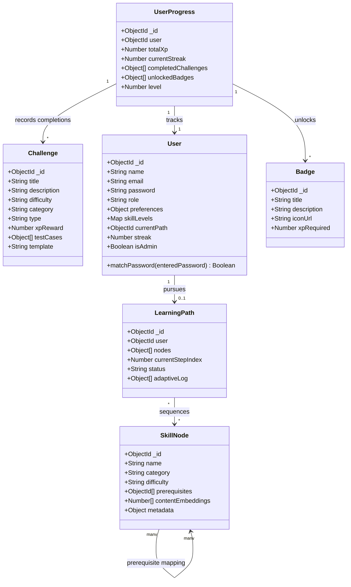

# 🗄️ CodeGalaxy: Entity-Relationship & UML Class Diagram Specification

## Figure 3: Entity-relationship / class diagram of the core Mongoose schemas: User, UserProgress, LearningPath, SkillNode, Challenge, and Badge.

---

### 1. Vector Mermaid Class / ER Diagram

---

## 2. Core Mongoose Schema Specifications

### **1. SkillNode** ([backend/models/SkillNode.js](file:///c:/Users/harsh/OneDrive/Desktop/CodeGalaxy%20AD/backend/models/SkillNode.js))
- **Role**: Represents individual planetary nodes in the CodeGalaxy Solar System skill tree (e.g., Variables, Loops, Binary Search Trees).
- **Key Attributes**:
  - `_id`: Unique MongoDB ObjectId identifier.
  - `name`: Human-readable skill name (unique).
  - `category`: Domain tag (e.g., 'Syntax', 'DataStructures', 'Algorithms').
  - `difficulty`: Enum `['Beginner', 'Intermediate', 'Advanced']`.
  - `prerequisites`: Self-referencing array of `SkillNode` ObjectIds (many-to-many DAG structure).
  - `contentEmbeddings`: Dense vector embeddings array for similarity scoring & Qdrant integration.
  - `metadata`: Estimated time, media types, and pedagogical hints.

---

### **2. UserProgress** ([backend/models/UserProgress.js](file:///c:/Users/harsh/OneDrive/Desktop/CodeGalaxy%20AD/backend/models/UserProgress.js))
- **Role**: Central telemetry hub aggregating learner XP, daily streaks, level progression, and gamification rewards.
- **Key Attributes**:
  - `_id`: Unique identifier.
  - `user`: Foreign key pointing to `User` (1-to-1 relationship, unique).
  - `totalXp`: Cumulative experience points earned across challenges and quizzes.
  - `currentStreak`: Consecutive days of platform activity.
  - `completedChallenges`: Array tracking completed challenge ObjectIds, timestamps, and scores.
  - `unlockedBadges`: Array of unlocked badge ObjectIds and grant timestamps.
  - `level`: Computed learner level (e.g., Level 1 Cadet to Level 50 Galaxy Master).

---

### **3. User** ([backend/models/User.js](file:///c:/Users/harsh/OneDrive/Desktop/CodeGalaxy%20AD/backend/models/User.js))
- **Role**: Core authentication and learner profile entity.
- **Key Attributes**:
  - `_id`: Unique identifier.
  - `name`: User full name or galactic callsign.
  - `email`: User email (unique, indexing key).
  - `password`: Salted `bcryptjs` hash string.
  - `role`: Enum `['student', 'teacher', 'admin']`.
  - `preferences`: Preferred learning style (`Visual`, `Text`, `Interactive`), pace, and target goal.
  - `skillLevels`: Key-value map of domain ratings (level, score, confidence).
  - `currentPath`: Reference to active `LearningPath` ObjectId.
  - `streak`: Current activity streak count.
- **Instance Method**:
  - `+ matchPassword(enteredPassword)`: Compares candidate plaintext password with stored bcrypt hash.

---

### **4. Challenge** ([backend/models/Challenge.js](file:///c:/Users/harsh/OneDrive/Desktop/CodeGalaxy%20AD/backend/models/Challenge.js))
- **Role**: Coding problems, algorithmic exercises, and AI-generated Nebula Forge challenges.
- **Key Attributes**:
  - `_id`: Unique challenge identifier.
  - `title`: Problem title (e.g., 'Two Sum', 'Reverse Linked List').
  - `description`: Detailed markdown problem description.
  - `difficulty`: Enum `['Easy', 'Medium', 'Hard']`.
  - `category`: Conceptual grouping.
  - `type`: Problem modality (`Algorithm`, `Debugging`, `SystemDesign`).
  - `xpReward`: Experience points awarded upon passing all test cases (default: 100 XP).
  - `testCases`: Array of `{ input, expectedOutput, isHidden }` objects.
  - `template`: Initial starter boilerplate code provided in the Monaco editor.

---

### **5. Badge** ([backend/models/Gamification/Badge.js](file:///c:/Users/harsh/OneDrive/Desktop/CodeGalaxy%20AD/backend/models/Gamification/Badge.js))
- **Role**: Gamification achievements and galactic milestones.
- **Key Attributes**:
  - `_id`: Unique badge identifier.
  - `title` / `name`: Achievement title (e.g., 'First Orbit', 'Recursion Master').
  - `description`: Criteria explanation and lore.
  - `iconUrl`: Static asset path or SVG icon.
  - `xpRequired`: Unlock threshold or criteria map (`challenges_completed`, `xp_earned`).

---

### **6. LearningPath** ([backend/models/LearningPath.js](file:///c:/Users/harsh/OneDrive/Desktop/CodeGalaxy%20AD/backend/models/LearningPath.js))
- **Role**: Dynamic, personalized curricular roadmap generated and adapted by the AI Agent.
- **Key Attributes**:
  - `_id`: Unique path identifier.
  - `user`: Foreign key pointing to `User`.
  - `nodes`: Array of `{ skillNode, status, score, unlockedAt, completedAt }` where status is `['Locked', 'Unlocked', 'In Progress', 'Completed', 'Skipped']`.
  - `currentStepIndex`: Cursor tracking active node index.
  - `status`: Enum `['Active', 'Completed', 'Archived']`.
  - `adaptiveLog`: Audit trail of AI modifications (e.g., "Added Remedial Node on Recursion").

---

## 3. Cardinality & Association Summary

| Relationship | Multiplicity | Type | Semantics |
|---|:---:|:---:|---|
| **SkillNode ➔ SkillNode** | `*` to `*` | Self-Referencing Association | Prerequisite tree / DAG mapping. |
| **UserProgress ➔ User** | `1` to `1` | One-to-One Composition | Tracks real-time gamification stats for a specific user. |
| **UserProgress ➔ Challenge** | `1` to `*` | One-to-Many Association | Records history of completed challenges and scores. |
| **UserProgress ➔ Badge** | `1` to `*` | One-to-Many Association | Tracks list of badges unlocked by the learner. |
| **User ➔ LearningPath** | `1` to `0..1` | One-to-Optional Aggregation | A learner pursues at most one active adaptive learning path at a time. |
| **LearningPath ➔ SkillNode** | `*` to `*` | Many-to-Many Association | An adaptive path orchestrates an ordered sequence of planetary skill nodes. |
