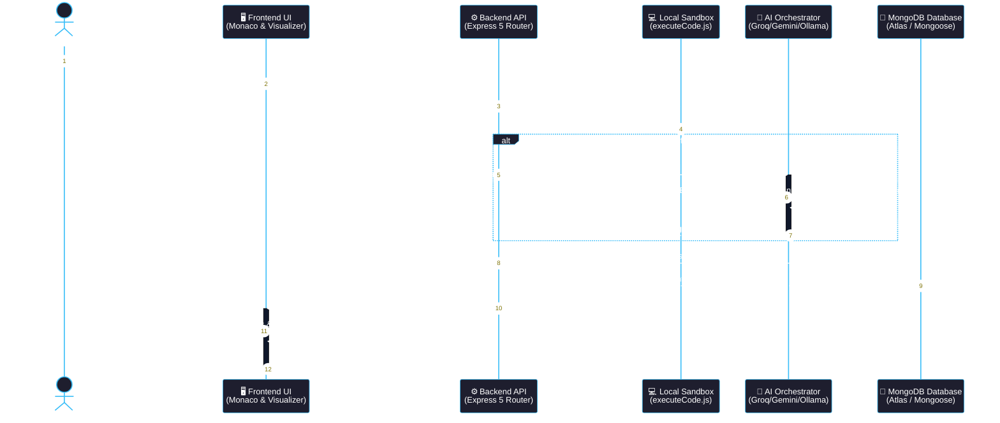

# ⏱️ CodeGalaxy: UML Sequence Diagram Specification

## Figure 5: Sequence diagram for a code submission that triggers AI-assisted repair, from the Learner through the Frontend UI, Backend API, Local Sandbox, AI Orchestrator, and MongoDB.

---

### 1. Vector Mermaid Sequence Diagram

---

## 2. Step-by-Step Message & Lifecycle Sequence

### **1. Trigger & Client Input**
- **Action**: Learner writes code in the Monaco Editor and clicks the **"Run Code"** or **"Submit Solution"** action button.
- **Client State**: Captures source code, active language (`js`, `py`, `cpp`, `java`), and optional custom `stdin` inputs.

### **2. HTTP Request Dispatch**
- **Protocol**: `POST /api/challenges/run` with Bearer JWT token header.
- **Middleware**: Express validates JWT credentials via `authMiddleware.protect`, binding authenticated user profile to `req.user`.

### **3. Sandboxed Compilation & Local Execution**
- **Engine**: [executeCode.js](file:///c:/Users/harsh/OneDrive/Desktop/CodeGalaxy%20AD/backend/utils/executeCode.js).
- **Workflow**:
  - Generates temporary code file with UUID naming inside `backend/temp_codes/`.
  - Spawns compiler/runtime process (`g++`, `gcc`, `python`, `node`, `javac`) with child process execution timeout bound to **8 seconds**.
  - Collects `stdout` outputs, compiler diagnostic warnings (`stderr`), and execution millisecond timing.

### **4. Conditional AI Repair Branch (`alt` block)**
- **Condition**: Triggers when compiler returns exit code $\neq 0$ or test cases fail assertion checks.
- **Payload**: Dispatches `{ code, language, error: stderr, expectedOutput, actualOutput }` to `aiController.repairActiveCode`.
- **Reasoning Loop**: `agentService.js` coordinates multi-agent analysis:
  1. **Planner**: Identifies the buggy lines and missing edge cases.
  2. **Executor**: Generates contextual code fix recommendations and explanations.
  3. **Synthesizer**: Consolidates output into clean, spoiler-free markdown guidance.

### **5. Database State & Gamification Persistence**
- **Mongoose Models**: [UserProgress](file:///c:/Users/harsh/OneDrive/Desktop/CodeGalaxy%20AD/backend/models/UserProgress.js) and [User](file:///c:/Users/harsh/OneDrive/Desktop/CodeGalaxy%20AD/backend/models/User.js).
- **Operations**:
  - Increments cumulative `totalXp` and daily `currentStreak`.
  - Records challenge completion entry in `completedChallenges`.
  - Checks milestone criteria to award new galactic badges or unlock subsequent planetary skill nodes.

### **6. Result Serialization & Client Rendering**
- **Payload**: JSON payload containing sandbox execution output, pass/fail status, runtime duration, AI repair advice, and updated XP telemetry.
- **Visual Reaction**:
  - Monaco Editor highlights offending code lines.
  - Interactive terminal window displays test case results and timings.
  - Algorithm Visualizer dynamically renders execution states.
  - Solar System LevelMap updates unlocked planetary orbits.
