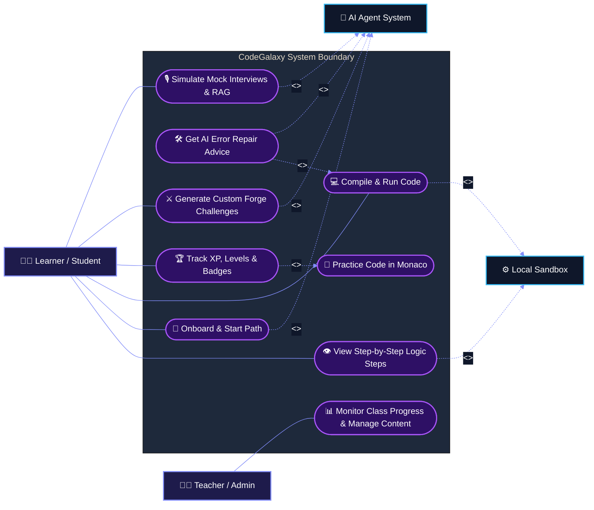

# 🎯 CodeGalaxy: UML Use-Case Diagram Specification

## Figure 4: Use-case diagram: Learner/Student and Teacher/Admin actors against the CodeGalaxy system boundary, with the Local Sandbox and AI Agent System as included/extending subsystems.

---

### 1. Vector Mermaid UML Use-Case Diagram

---

## 2. Actors Specification

| Actor | Category | Description | Primary Permissions & Responsibilities |
|---|---|---|---|
| **Learner / Student** | Primary (Human) | Core platform learner who writes code, unlocks planetary skill paths, and takes AI quizzes. | Complete learning paths, submit solutions, earn XP/badges, trigger code repairs, generate practice challenges, and simulate mock interviews. |
| **Teacher / Admin** | Secondary (Human) | Educator or system administrator managing content and monitoring class performance. | Review cohort progression, track student completion rates, inspect leaderboard metrics, and manage challenge inventories. |
| **Local Sandbox** | Supporting Subsystem | Isolated OS execution environment running compiled runtimes. | Compiles and executes untrusted code (`g++`, `gcc`, `python`, `node`, `javac`) with an 8s timeout and returns execution output. |
| **AI Agent System** | Supporting Subsystem | Multi-provider cognitive agentic infrastructure (Groq, Gemini, Ollama). | Performs 3-stage agentic reasoning (**Plan ➔ Execute ➔ Synthesize**), diagnoses errors, generates custom problems, and conducts mock interviews. |

---

## 3. Detailed Use-Case Descriptions & Relationships

### **UC1: View Step-by-Step Logic Steps**
- **Actor**: Learner / Student
- **Subsystem Included**: Local Sandbox (`<<include>>`)
- **Description**: Learners execute sorting algorithms (Bubble, Quick, Merge, Selection) or data structure pointer adjustments (LinkedLists, BST) and watch live step-by-step visual transitions.

### **UC2: Onboard & Start Path**
- **Actor**: Learner / Student
- **Subsystem Included**: AI Agent System (`<<include>>`)
- **Description**: Learner completes a diagnostic pre-assessment. The AI Agent analyzes strengths and dynamically generates a personalized solar-system learning roadmap.

### **UC3: Compile & Run Code**
- **Actor**: Learner / Student
- **Subsystem Included**: Local Sandbox (`<<include>>`)
- **Description**: Compiles source code against sample test cases in real-time, piping `stdin` and rendering `stdout`/`stderr` inside the terminal window.

### **UC4: Get AI Error Repair Advice**
- **Relationship**: Extends **UC3: Compile & Run Code** (`<<extend>>`)
- **Subsystem Included**: AI Agent System (`<<include>>`)
- **Description**: When compilation or runtime exceptions occur, the learner can optionally invoke the AI repair assistant to diagnose root causes and suggest fix steps without giving away spoilers.

### **UC5: Practice Code in Monaco**
- **Relationship**: Included by **UC6: Track XP, Levels & Badges** (`<<include>>`)
- **Description**: Full-screen Monaco IDE providing language syntax highlighting, auto-complete, multi-language boilerplates, and dark mode galactic styling.

### **UC6: Track XP, Levels & Badges**
- **Actor**: Learner / Student
- **Description**: Displays the learner's planetary progress, XP bar, daily coding streak, pilot license certificates, and leaderboard ranking.

### **UC7: Generate Custom Forge Challenges**
- **Actor**: Learner / Student
- **Subsystem Included**: AI Agent System (`<<include>>`)
- **Description**: Learner enters an algorithmic topic or problem prompt. The AI Forge dynamically synthesizes problem instructions, constraints, starter templates, and test cases.

### **UC8: Simulate Mock Interviews & RAG**
- **Actor**: Learner / Student
- **Subsystem Included**: AI Agent System (`<<include>>`)
- **Description**: Conducts conversational technical mock interviews with speech-to-text/audio feedback, adaptive quiz questioning, and multimodal document Q&A over uploaded PDFs or screenshots.

### **UC9: Monitor Class Progress & Manage Content**
- **Actor**: Teacher / Admin
- **Description**: Administrative dashboard allowing educators to view student cohorts, analyze class completion rates, track learner struggle points, and publish new coding challenges.
